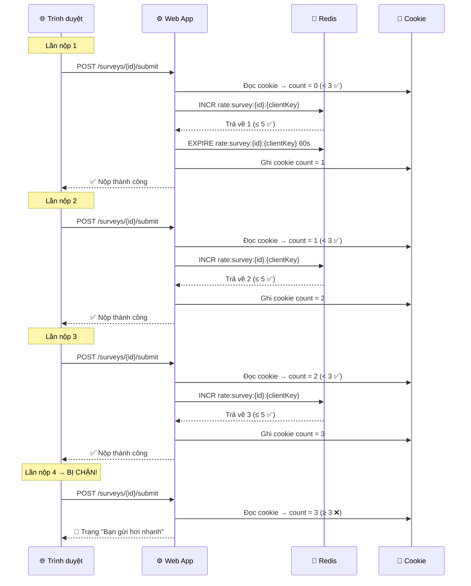
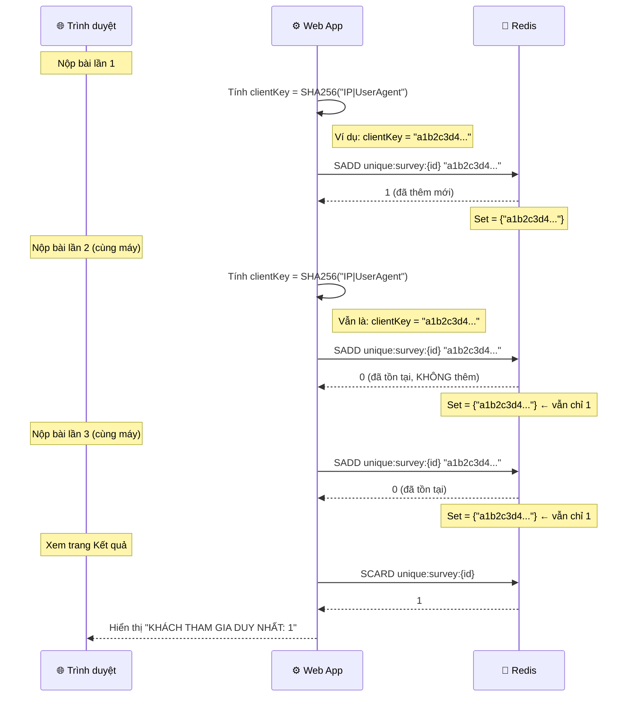
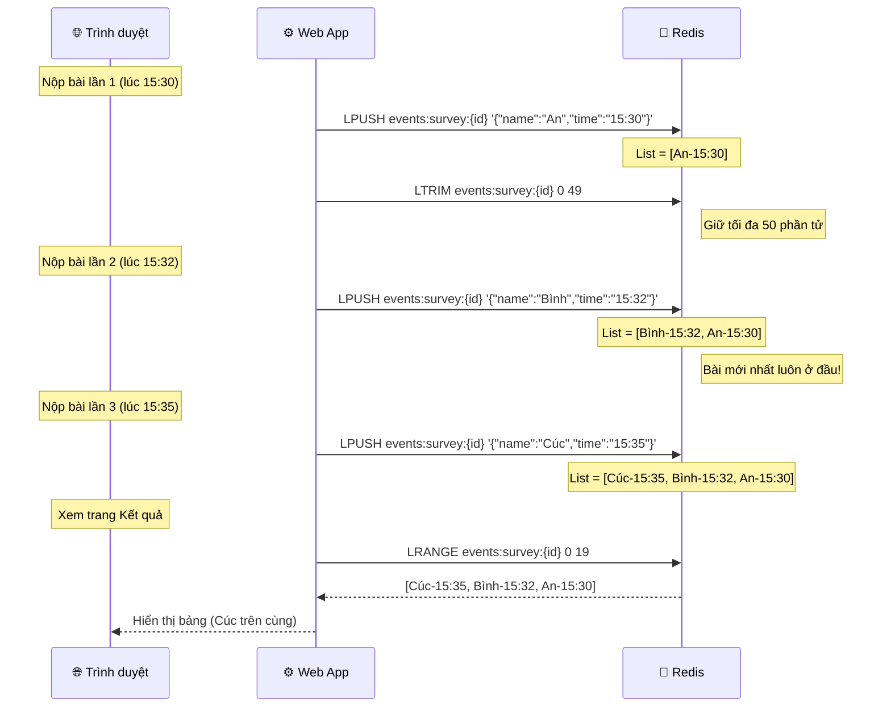
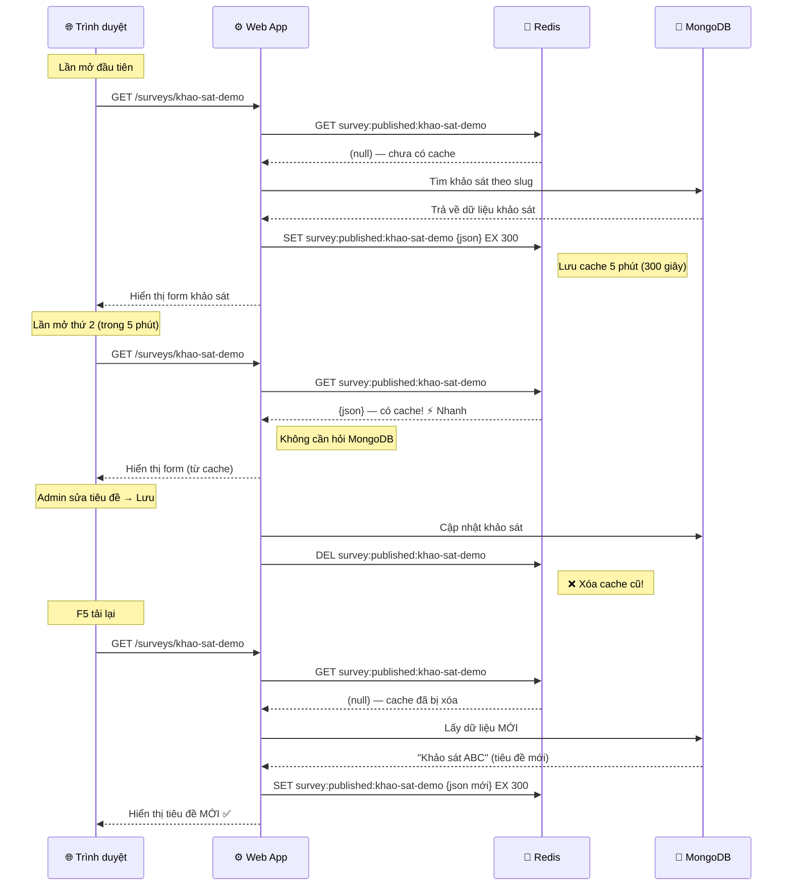

# Hướng dẫn Test 4 cấu trúc dữ liệu Redis — Giải thích chi tiết

> Tất cả test đều thực hiện trên trình duyệt tại **http://localhost:5080**

---

## 🔐 Chuẩn bị (chung cho cả 4 test)

1. Đăng nhập admin: `http://localhost:5080/account/login`
   - User: **admin** / Pass: **Admin@12345**
2. Tạo 1 khảo sát mới → bấm **Xuất bản**
3. Copy link khảo sát: `/surveys/{slug}` (ví dụ: `/surveys/khao-sat-demo`)

---

## Test 1: INCR (STRING dạng đếm) — Chống spam nộp bài

### Cách test

1. Mở link khảo sát `/surveys/khao-sat-demo` ở **tab ẩn danh** (Ctrl+Shift+N)
2. Điền đầy đủ form → bấm **Nộp bài**
3. Quay lại link khảo sát → điền lại → **Nộp bài lần 2**
4. Tiếp tục **lần 3** → vẫn nộp được bình thường
5. **Lần thứ 4** → web hiện trang: **"Bạn gửi hơi nhanh"**

### Chuyện gì xảy ra phía sau?

### Giải thích dễ hiểu

Hệ thống có **2 lớp bảo vệ** chống spam:

| Lớp | Công nghệ | Cách hoạt động |
|-----|-----------|----------------|
| **Lớp 1: Cookie** | Cookie trình duyệt | Đếm số lần nộp trên trình duyệt. Đến lần thứ 4 (count ≥ 3) → chặn ngay, **không cần hỏi Redis** |
| **Lớp 2: Redis INCR** | Redis STRING + INCR | Nếu ai đó xóa cookie để lách, Redis vẫn đếm theo IP+UserAgent. Quá 5 lần/phút → chặn |

**Tại sao bị chặn ở lần 4?** Vì **Cookie chặn trước** (≥ 3 lần). Redis INCR là lớp dự phòng nếu người dùng xóa cookie.

> **Redis command sử dụng:**
> - `INCR rate:survey:{id}:{clientKey}` — tăng bộ đếm lên 1
> - `EXPIRE rate:survey:{id}:{clientKey} 60` — tự xóa key sau 60 giây

> **Code:** [SurveyService.cs — AllowSubmissionAsync](file:///c:/Users/congn/Downloads/DeTai6Nosql/DeTai6Nosql/OnlineSurvey/Services/SurveyService.cs#L113-L140)
> **Code:** [SurveysController.cs — Cookie check](file:///c:/Users/congn/Downloads/DeTai6Nosql/DeTai6Nosql/OnlineSurvey/Controllers/SurveysController.cs#L67-L80)

---

## Test 2: SET — Đếm khách tham gia duy nhất

### Cách test

1. Sau khi nộp 2-3 bài ở Test 1 (trên cùng 1 máy)
2. Quay lại **Quản trị** → bấm nút **Kết quả** của khảo sát đó
3. Nhìn ô thẻ thứ 2: **"KHÁCH THAM GIA DUY NHẤT"**
4. **Giá trị = 1** (dù bạn nộp 2-3 bài)

### Chuyện gì xảy ra phía sau?

### Giải thích dễ hiểu

Hãy tưởng tượng Redis SET như **hộp bi**, mỗi viên bi có tên riêng:

| Hành động | Viên bi | Kết quả |
|-----------|---------|---------|
| Nộp lần 1 từ máy A | Bỏ bi "a1b2c3d4" vào hộp | Hộp có **1 bi** |
| Nộp lần 2 từ máy A | Bỏ bi "a1b2c3d4" vào hộp | Bi đã có rồi → **vẫn 1 bi** |
| Nộp lần 3 từ máy A | Bỏ bi "a1b2c3d4" vào hộp | Bi đã có rồi → **vẫn 1 bi** |
| Nộp lần 1 từ máy B | Bỏ bi "x5y6z7w8" vào hộp | Bi mới → **2 bi** |

**SET không bao giờ chứa phần tử trùng nhau** → dù nộp bao nhiêu lần trên cùng 1 máy, chỉ đếm là **1 khách duy nhất**.

> **Redis command sử dụng:**
> - `SADD unique:survey:{id} {clientKey}` — thêm vào Set (tự bỏ qua nếu trùng)
> - `SCARD unique:survey:{id}` — đếm số phần tử trong Set

> **Code:** [SurveyService.cs — TrackUniqueRespondentAsync](file:///c:/Users/congn/Downloads/DeTai6Nosql/DeTai6Nosql/OnlineSurvey/Services/SurveyService.cs#L150-L163)
> **Code:** [SurveyService.cs — GetUniqueRespondentCountAsync](file:///c:/Users/congn/Downloads/DeTai6Nosql/DeTai6Nosql/OnlineSurvey/Services/SurveyService.cs#L168-L181)

---

## Test 3: LIST — Nhật ký sự kiện gửi gần đây

### Cách test

1. Vẫn ở trang **Kết quả**, kéo xuống phần **"Sự kiện gửi gần đây (Redis LIST)"**
2. Bài bạn nộp **gần nhất luôn nằm dòng 1** (trên cùng)
3. Nộp thêm 1 bài mới → vào lại Kết quả → bài mới **đẩy lên đầu**, bài cũ tụt xuống

### Chuyện gì xảy ra phía sau?

### Giải thích dễ hiểu

Hãy tưởng tượng Redis LIST như **chồng giấy trên bàn**:

| Hành động | Chồng giấy (nhìn từ trên xuống) |
|-----------|----------------------------------|
| An nộp bài lúc 15:30 | **An** |
| Bình nộp bài lúc 15:32 | **Bình** → An |
| Cúc nộp bài lúc 15:35 | **Cúc** → Bình → An |

- `LPUSH` = **đặt tờ giấy mới lên TRÊN CÙNG** chồng giấy
- `LRANGE 0 19` = **lấy 20 tờ trên cùng** để hiển thị
- `LTRIM 0 49` = nếu chồng quá 50 tờ, bỏ bớt tờ cũ ở dưới đáy

→ Khi mở trang Kết quả, **bài nộp mới nhất luôn hiện đầu tiên**.

> **Redis command sử dụng:**
> - `LPUSH events:survey:{id} {json}` — đẩy sự kiện vào đầu danh sách
> - `LTRIM events:survey:{id} 0 49` — giữ tối đa 50 sự kiện
> - `LRANGE events:survey:{id} 0 19` — lấy 20 sự kiện gần nhất

> **Code:** [SurveyService.cs — PushRecentEventAsync](file:///c:/Users/congn/Downloads/DeTai6Nosql/DeTai6Nosql/OnlineSurvey/Services/SurveyService.cs#L187-L201)
> **Code:** [SurveyService.cs — GetRecentEventsAsync](file:///c:/Users/congn/Downloads/DeTai6Nosql/DeTai6Nosql/OnlineSurvey/Services/SurveyService.cs#L206-L220)

---

## Test 4: STRING — Cache biểu mẫu 5 phút

### Cách test

1. Mở link khảo sát `/surveys/khao-sat-demo` (lần đầu: đọc từ MongoDB → lưu cache Redis)
2. Quay lại **Quản trị** → bấm **Sửa** → đổi tiêu đề thành "Khảo sát ABC" → **Lưu**
3. Quay lại link khảo sát → **F5 tải lại**
4. **Tiêu đề đã đổi thành "Khảo sát ABC"** → cache cũ đã bị xóa

### Chuyện gì xảy ra phía sau?

### Giải thích dễ hiểu

Hãy tưởng tượng Redis STRING cache như **bảng ghi chú trên tủ lạnh**:

| Tình huống | Hành động |
|------------|-----------|
| Khách mở khảo sát lần đầu | Đọc từ MongoDB (chậm) → **dán ghi chú lên tủ lạnh** (cache 5 phút) |
| Khách mở lại trong 5 phút | Đọc ghi chú trên tủ (Redis) → **siêu nhanh**, không cần mở MongoDB |
| Admin sửa khảo sát | **Xé bỏ ghi chú cũ** (`DEL`) → lần sau phải đọc MongoDB lại |
| Quá 5 phút không ai mở | Ghi chú **tự rơi** (hết hạn TTL) |

→ Khi F5 sau khi sửa: cache cũ đã bị xóa → đọc dữ liệu MỚI từ MongoDB → hiển thị đúng tiêu đề mới.

> **Redis command sử dụng:**
> - `GET survey:published:{slug}` — đọc cache
> - `SET survey:published:{slug} {json} EX 300` — ghi cache, hết hạn sau 5 phút
> - `DEL survey:published:{slug}` — xóa cache khi admin sửa

> **Code:** [SurveyService.cs — GetPublishedBySlugAsync](file:///c:/Users/congn/Downloads/DeTai6Nosql/DeTai6Nosql/OnlineSurvey/Services/SurveyService.cs#L37-L83)
> **Code:** [SurveyService.cs — InvalidateAsync](file:///c:/Users/congn/Downloads/DeTai6Nosql/DeTai6Nosql/OnlineSurvey/Services/SurveyService.cs#L141-L156)

---

## Tóm tắt 4 cấu trúc Redis

| # | Cấu trúc | Redis Key | Command chính | Mục đích |
|---|----------|-----------|---------------|----------|
| 1 | **STRING + INCR** | `rate:survey:{id}:{client}` | `INCR`, `EXPIRE` | Đếm & chặn spam nộp bài |
| 2 | **SET** | `unique:survey:{id}` | `SADD`, `SCARD` | Đếm khách duy nhất (loại trùng) |
| 3 | **LIST** | `events:survey:{id}` | `LPUSH`, `LTRIM`, `LRANGE` | Nhật ký sự kiện gần đây |
| 4 | **STRING** | `survey:published:{slug}` | `GET`, `SET EX`, `DEL` | Cache biểu mẫu 5 phút |
